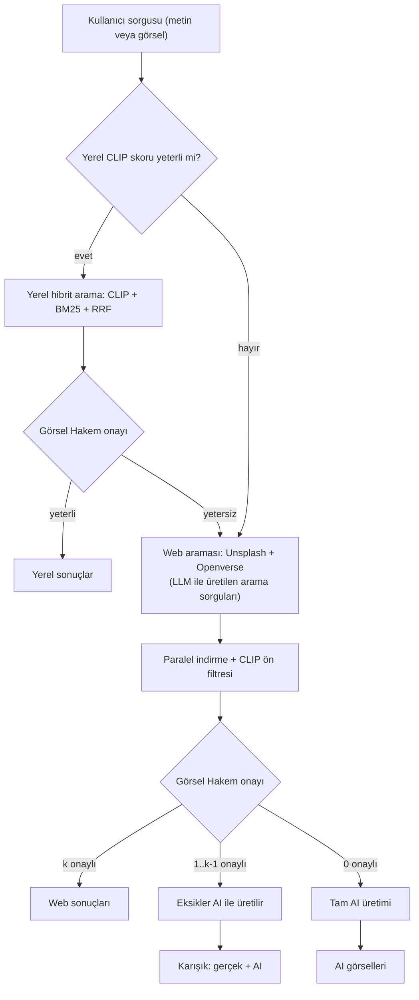

# 🔍 Multi-Modal Semantik Görsel Arama Motoru

**Çok Modlu Gömme ve Hibrit Bilgi Getirimi Tabanlı Semantik Görsel Arama Platformu**

**Durum:** Aktif geliştirme (Bilgisayar Mühendisliği bitirme projesi)
**Mimari:** Üç katmanlı arama (yerel hibrit → web → yapay zeka üretimi) + Görsel Hakem (VLM doğrulaması)
**Servisler:** FastAPI (arka uç) + Streamlit (arayüz)

## 📌 Proje Özeti

Metin ya da görsel sorgusuyla çalışan bir görsel arama sistemidir. Amaç, kullanıcının yazdığı şeyin gerçekten görüldüğü bir fotoğrafı bulmak, bulunamazsa bunu açıkça belirterek yapay zeka ile üretmektir. Her sonuç kaynağıyla etiketlenir (📁 yerel, 📷 web, 🎨 yapay zeka), kullanıcı neye baktığını her zaman bilir.

1. **Yerel arama:** 5.000 görsellik COCO val2017 veri setinde CLIP (anlamsal) + BM25 (anahtar kelime) araması Reciprocal Rank Fusion (RRF) ile birleştirilir.
2. **Web araması:** Yerel eşleşme zayıfsa Unsplash ve Openverse'ten gerçek fotoğraflar getirilir. Adaylar önce CLIP ile elenir, sonra Görsel Hakem (Groq üzerinde çok kipli bir model) "bu fotoğraf sorgudaki her öğeyi gösteriyor mu?" sorusuyla doğrular.
3. **Yapay zeka üretimi:** Web'de yeterli doğrulanmış fotoğraf yoksa, eksik kalan kadar görsel üretilir. Gerçek fotoğraflar korunur, eksikler AI ile tamamlanır (kısmi tamamlama).

## 🏗️ Sistem Mimarisi



### Karar Kuralları

- **Yerel katman:** En iyi yerel CLIP skoru ≥ 0.29 ise hibrit arama adayları (en fazla 6) Görsel Hakem'den geçirilir. `k` aday onaylanırsa ya da en az 1 aday onaylanıp CLIP skoru ≥ 0.32 ise yerel sonuç döner, aksi halde web'e geçilir.
- **Web katmanı:** Adaylar CLIP skoru ≥ 0.25 ile elenir, en iyi `k+1` aday Görsel Hakem'e sorulur. `k` onay varsa web sonucu, 1..k-1 onay varsa gerçek + AI karışımı, hiç onay yoksa tam AI üretimi döner.
- **AI üretimi:** Sorgu, Groq üzerindeki bir LLM ile ana özneyi koruyan bir prompta çevrilir (4 farklı kadraj yönlendirmesi). Görsel üretimi sırasıyla Hugging Face FLUX.1-schnell → Pollinations (FLUX) → Pollinations (SDXL-Turbo) zincirinden gider ve paralel çalışır.
- **Görsel yükleyerek arama:** Yerel görsel-görsel benzerlik eşiği 0.75'tir (görsel-görsel CLIP skorları metin-görsel skorlarından doğal olarak yüksektir). Eşik aşılmazsa görsel BLIP ile metne çevrilir ve metin zincirine verilir.

## 🧰 Teknoloji Yığını

| Katman | Teknoloji |
|---|---|
| Gömme (embedding) | OpenCLIP ViT-B/32 (`laion2b_s34b_b79k`) |
| Görsel tarif (caption) | BLIP (`Salesforce/blip-image-captioning-base`) |
| Vektör arama | FAISS (Flat / IVF / HNSW karşılaştırıldı, HNSW seçildi) |
| Anahtar kelime araması | rank-bm25 (BLIP caption'ları üzerinde) |
| Birleştirme | Reciprocal Rank Fusion (RRF) |
| Web kaynakları | Unsplash API, Openverse API (anahtarsız) |
| Prompt / arama sorgusu üretimi | Groq: `openai/gpt-oss-20b` |
| Görsel Hakem (VLM) | Groq: `qwen/qwen3.8-27b` |
| Görsel üretimi | FLUX.1-schnell (Hugging Face), yedek: Pollinations (bulut) |
| Arka uç / Arayüz | FastAPI / Streamlit |

## 🚀 Çalıştırma

Python 3.12 ile test edilmiştir. Sıfırdan kurulmuş temiz bir sanal ortamda `requirements.txt`, API ve arayüz doğrulanmıştır.

```bash
git clone <repo-adresi>
cd <repo-klasoru>
python -m venv venv
venv\Scripts\activate          # Linux/Mac: source venv/bin/activate
pip install -r requirements.txt
```

Proje köküne bir `.env` dosyası oluştur (**asla commit etme**):

```
UNSPLASH_ACCESS_KEY=...
HF_TOKEN=...
GROQ_API_KEY=...
```

### Veri hazırlığı (bir kez)

COCO val2017 görselleri `data/raw_images/` altına konur (veri repoda yoktur), ardından sırasıyla:

```bash
python embeddings/build_full_index.py   # CLIP gömmeleri (5.000 görsel)
python embeddings/build_captions.py     # BLIP caption'ları (CPU'da yaklaşık 70 dk)
python index/faiss_index.py             # FAISS indeksleri
```

### Servisleri başlat (iki ayrı terminal)

```bash
uvicorn api.main:app --reload
```

```bash
streamlit run ui/app.py
```

Arayüz: `http://localhost:8501` · API dokümanı: `http://localhost:8000/docs`

### Test

API açıkken:

```bash
python -m pytest tests/test_api.py -v
```

## 🔌 API Uç Noktaları

| Uç nokta | Açıklama |
|---|---|
| `GET /health` | Servis sağlık kontrolü |
| `POST /search/text` | `{"sorgu": "a winged dog", "k": 4}`, üç katmanlı arama |
| `POST /search/image` | Görsel yükle, benzerlerini bul (zayıfsa BLIP ile metne çevrilip zincire girer) |

## 📊 Değerlendirme

Yerel katman, BLIP'ten **bağımsız** iki test setiyle ölçülmüştür (COCO'nun insan yazımı anotasyonları): 77 kısa kategori sorgusu ve 200 insan caption sorgusu. İlk setin (BLIP caption'larından türetilmiş 50 sorgu) BM25'e haksız avantaj sağladığı görüldüğü için kullanılmamıştır.

| Yaklaşım | Precision@5 (kategori) | Recall@5 (caption) | MRR@5 (caption) |
|---|---|---|---|
| CLIP | 0.873 | 0.655 | 0.523 |
| BM25 | 0.852 | 0.210 | 0.113 |
| Hibrit (RRF) | 0.904 | 0.575 | 0.380 |

Rastgele seçimle Precision@5 = 0.031. Eşlemeli bootstrap (10.000 tekrar, %95 aralık) sonuçları:

- Hibrit, BM25'ten insan caption sorgularında açık farkla iyidir.
- Kısa kategori sorgularında hibrit ile CLIP arasındaki fark **ayırt edilemez**.
- İnsan caption sorgularında hibrit, CLIP'ten **daha kötüdür**. BM25'e daha düşük ağırlık vermek de bunu kurtarmadı. Hibrit mimari korunuyor, bulgu bir ablation sonucu olarak belgeleniyor.

HNSW indeksi, Flat'e göre yaklaşık 8 kat hızlıdır (~%97 sonuç örtüşmesi).

### Görsel Hakem pilot ölçümü

12 sorgu (3'ü kolay kontrol), Unsplash + Openverse'ten 177 aday, kör etiketleme. CLIP eşiğini (0.25) geçen 83 aday üzerinde:

| | Sonuç |
|---|---|
| Hakem gerçek isabetleri kabul etti | 38/47 (%80.9, kaba %95 aralık ≈ %67-90) |
| Hakem isabetsizleri kabul etti | 2/36 (%5.6, ≈ %2-18) |

CLIP eşiği tek başına puanlanan 57 isabetsiz adayın 36'sını (%63) geçirmiştir. Hakem bunlardan 34'ünü elemiştir. Bedeli, gerçek isabetlerin yaklaşık beşte birinin reddedilmesidir. Retler, üç öğeli ve ilişkili sorgularda yoğunlaşır (örneğin `a man holding an umbrella next to a dog`: 1/5 kabul), basit sorgularda hakem 29/29 isabeti kabul etmiştir. Uyuşmazlıkların gözle incelenmesinde bir etiket hatası bulunmuştur (düzeltilmiş okuma: 39/48 ve 1/35). Bu bir **pilot ölçümdür**: örneklem küçük, tek etiketleyici, aday havuzunun neredeyse tamamı Unsplash'tir.

Havuz kalitesi: 12 sorgunun 3'ünde (`a horse with horns`, `a blue car in front of a yellow house`, `a cup on top of a laptop`) iki kaynakta da hiç isabet yoktur. Bu sorgular yapay zeka üretimine düşer.

## ⚠️ Bilinen Sınırlamalar

- **Görsel Hakem günlük token sınırı:** Groq hesabında hakem modeli için günlük 200K token sınırı vardır (yaklaşık 100 hakem çağrısı). Hakem hata alınca güvenlik için "red" döndürür. Sınır dolunca gerçek fotoğrafların sessizce reddedilip yapay zeka görsellerine düşülmesi beklenir (kod okunarak çıkarıldı, bu senaryo uçtan uca test edilmedi).
- **Hakem temkinlidir:** Pilot ölçümde gerçek isabetlerin ~%19'u reddedildi. Görseller hakeme 384 piksele küçültülerek gönderilir. Küçültmenin ince ayrıntıları silip silmediği inceleniyor (token maliyetini azaltmadığı ölçüldü).
- **Yapay zeka görselleri doğrulanmaz.** Kısmi tamamlamada AI ile üretilen görsel sorguyu tam karşılamayabilir ve filigran içerebilir (Pollinations yedeği). Üretim modelleri de bileşik kavramlarda ("köpek + kanat") zayıftır.
- **Openverse:** Testlerimizde Openverse küçük resim indirmeleri sıklıkla zaman aşımına uğradı (81 adayın 73'ü Python'dan indirilemedi), bu yüzden şu an katkısı sınırlıdır.
- **Eşikler:** Yerel eşik (0.29) 30 sorguluk kalibrasyonla (%93.3 doğruluk), web eşiği 0.25 ise tek bir örneğe dayanarak seçildi (0.24'ten yükseltildi). Etiketli veride iki eşik de isabetlerin %100'ünü geçirdi.
- **Telifli karakterler** birebir üretilemez (bilinçli sınırlama), hassas metin/logo üretimi diffusion modellerinin bilinen zayıflığıdır.
- **Gerçek ters görsel arama yoktur** (Google Görseller tarzı). Google Custom Search JSON API yeni müşterilere kapalıdır.
- **Üçüncü taraf ücretsiz servisler değişkendir:** Groq model katalog değişiklikleri, Hugging Face kredisi, Pollinations erişilebilirliği ve kullanım koşulları zamanla değişebilir. Sorgu metinleri bu servislere gönderilir.
- **Docker:** `Dockerfile.api`, `Dockerfile.ui` ve `docker-compose.yml` yazılmıştır, ancak geliştirme ortamında sürdürülebilir şekilde çalıştırılamamıştır; sistem `uvicorn` + `streamlit` ile gösterilmektedir.
- Değerlendirme örneklemleri küçüktür (pilot ölçüm 12 sorgu, tek etiketleyici). Sonuçlar yön gösterir, kesin üstünlük iddiası değildir.

## 📁 Proje Yapısı

```
api/            # FastAPI servisi
ui/             # Streamlit arayüzü
search/         # Hibrit arama, RRF, harici arama, Görsel Hakem, prompt üretimi, görsel üretimi
embeddings/     # CLIP kodlayıcı, BLIP caption üretici, indeks kurulum betikleri
index/          # FAISS ve BM25 indeksleri, benchmark
eval/           # Test setleri, değerlendirme ve ölçüm betikleri
tests/          # Entegrasyon testi
docs/           # Karar günlüğü, değerlendirme raporu
data/           # Veri, gömmeler, indeksler (repoda yok)
```

## 📝 Karar Günlüğü

Projede alınan her mimari karar, denenip vazgeçilenler dahil, sırasıyla `docs/karar_gunlugu.md` dosyasındadır. Değerlendirme ayrıntıları `docs/eval_raporu.md` dosyasındadır.

## 🙏 Kaynaklar ve Lisanslar

COCO val2017 veri seti (kullanım koşulları için bkz. cocodataset.org), OpenCLIP, BLIP, FAISS, rank-bm25, Groq, FLUX.1-schnell, Unsplash API (arayüzde fotoğrafçı adı gösterilir), Openverse (Creative Commons lisanslı içerik).